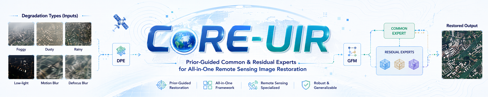
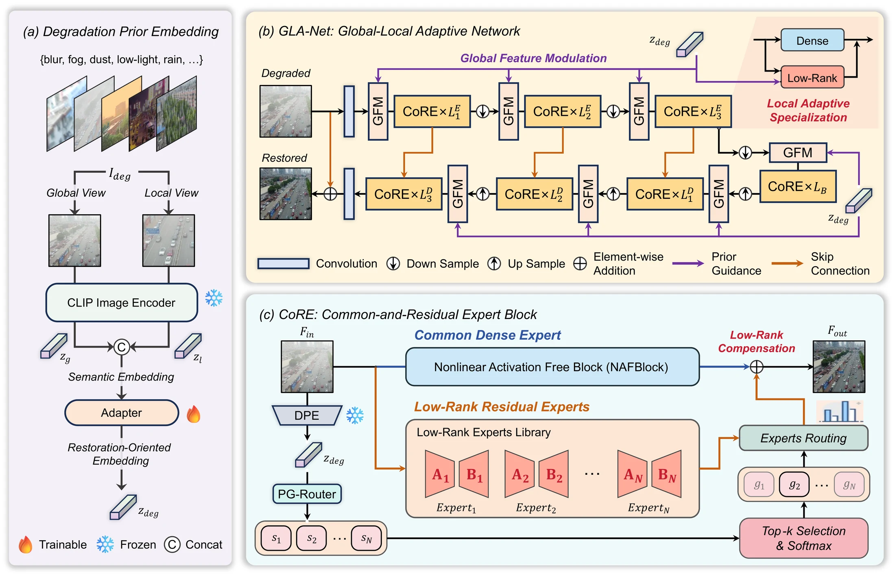
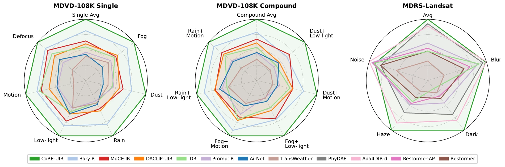

<div align="center">



## 🛰️ CoRE-UIR: Prior-Guided Common and Residual Experts for Efficient All-in-One Remote Sensing Image Restoration

**[ISPRS Journal of Photogrammetry and Remote Sensing](https://doi.org/10.1016/j.isprsjprs.2026.07.028), 2026**

[Zaiyan Zhang](https://zzaiyan.github.io/)<sup>1</sup>, Qiangqiang Yuan<sup>1,*</sup>, Jie Li<sup>1</sup>, Ziyang Lihe<sup>1</sup>, Yu Wan<sup>1</sup>, Yuzeng Chen<sup>1</sup>, Xin Su<sup>2</sup>, Liangpei Zhang<sup>3</sup>

<sup>1</sup>School of Geodesy and Geomatics, Wuhan University<br>
<sup>2</sup>School of Artificial Intelligence, Wuhan University<br>
<sup>3</sup>State Key Laboratory of Information Engineering in Surveying, Mapping and Remote Sensing, Wuhan University<br>
<sup>*</sup>Corresponding author

[](https://doi.org/10.1016/j.isprsjprs.2026.07.028)
[](https://arxiv.org/abs/2607.27898)
[](https://zzaiyan.github.io/assets/pubs/coreuir.pdf)
[](https://huggingface.co/datasets/zzaiyan/MDVD-108K)
[](LICENSE)

[Overview](#-overview) | [Results](#-results) | [Model Zoo](#-model-zoo) | [Quick Start](#-quick-start) | [Datasets](#-datasets) | [Citation](#-citation)

</div>

> **One model for diverse remote sensing image degradations.** CoRE-UIR combines degradation-aware guidance with common and residual experts to restore weather, illumination, imaging, and compound degradations efficiently.

## 🌍 Overview

CoRE-UIR is a prior-guided global-local framework for restoring diverse single and compound degradations in remote sensing imagery. It adapts frozen CLIP features into restoration-oriented priors and couples global feature modulation with local expert compensation in a unified backbone.

- **DPE and GFM:** DPE extracts restoration-oriented degradation priors from global and local views, while GFM aligns global feature statistics before local compensation.
- **CoRE block:** the primary structural innovation decomposes restoration into a common dense expert for degradation-invariant processing and sparsely routed low-rank residual experts for degradation-specific compensation.
- **MDVD-108K:** a large-scale UAV restoration benchmark covering six single degradations, six compound degradations, and real-world degraded images.

<p align="center">
  
</p>

## 📊 Results

CoRE-UIR achieves strong restoration quality across the UAV-based **MDVD-108K** benchmark and the satellite-based **MDRS-Landsat** benchmark. The radar charts summarize its performance over single, compound, and cross-domain degradation settings.

<p align="center">
  
</p>

## 🏆 Model Zoo

CoRE-UIR uses a Phase-I DPE checkpoint and a Phase-II restoration checkpoint. Place released weights under `pretrained/` with the following names.

| Benchmark | DPE setting | Experts | Routing | DPE checkpoint | Restoration checkpoint | Config |
| --- | --- | ---: | ---: | --- | --- | --- |
| MDVD-108K | 6-label, multi-label | 6 | Top-3 | `dpe_clip_b32_multilabel_mdvd.ckpt` | `core_uir_mdvd.pth` | [`core_uir_mdvd.yml`](configs/core_uir_mdvd.yml) |
| MDRS-Landsat | 4-class, single-label | 4 | Top-1 | `dpe_clip_b32_mdrs.ckpt` | `core_uir_mdrs.pth` | [`core_uir_mdrs.yml`](configs/core_uir_mdrs.yml) |

## ⚡ Quick Start

### 🛠️ Installation

```bash
conda create -n core-uir python=3.10 -y
conda activate core-uir
pip install torch torchvision --index-url https://download.pytorch.org/whl/cu124
pip install -r requirements.txt
```

The DPE encoder uses `openai/clip-vit-base-patch32` from Hugging Face and is downloaded automatically when first used.

### 🔍 Evaluation

```bash
# MDVD-108K
python test.py -opt configs/core_uir_mdvd.yml \
  --weights pretrained/core_uir_mdvd.pth --gpu 0 --no-resume

# MDRS-Landsat
python test.py -opt configs/core_uir_mdrs.yml \
  --weights pretrained/core_uir_mdrs.pth --gpu 0 --no-resume
```

### 🧠 Training

Train DPE first, then train the restoration network with the corresponding checkpoint in `pretrained/`.

```bash
# MDVD-108K
python train_dpe.py -opt configs/dpe_clip_b32_multilabel_mdvd.yml --gpu 0
python train.py -opt configs/core_uir_mdvd.yml --gpu 0 --no-resume

# MDRS-Landsat
python train_dpe.py -opt configs/dpe_clip_b32_mdrs.yml --gpu 0
python train.py -opt configs/core_uir_mdrs.yml --gpu 0 --no-resume
```

Phase-II training supports PyTorch DistributedDataParallel:

```bash
CUDA_VISIBLE_DEVICES=0,1 torchrun --nproc_per_node=2 --master_port=29500 \
  train.py -opt configs/core_uir_mdrs.yml --launcher pytorch --no-resume
```

## 🗺️ Datasets

### 🚁 MDVD-108K

[MDVD-108K](https://huggingface.co/datasets/zzaiyan/MDVD-108K) contains paired UAV images covering six single and six compound degradations, together with real-world degraded images and object-detection annotations.

```bash
hf download zzaiyan/MDVD-108K \
  --repo-type dataset \
  --local-dir datasets/MDVD-108K-release
```

Set `/path/to/MDVD-108K` in the MDVD configuration files to the extracted dataset root.

### 🛰️ MDRS-Landsat

MDRS-Landsat covers four satellite restoration tasks: deblurring, denoising, dehazing, and dedarkening. Set `/path/to/Landsat` in [`dpe_clip_b32_mdrs.yml`](configs/dpe_clip_b32_mdrs.yml) and [`core_uir_mdrs.yml`](configs/core_uir_mdrs.yml).

```text
Landsat/
+-- train/{cleanpng,blur,noise,haze,dark}/
+-- test/{cleanpng,blur,noise,haze,dark}/
```

## 📖 Citation

If CoRE-UIR or MDVD-108K supports your research, please cite:

```bibtex
@article{zhang2026coreuir,
  title     = {{CoRE-UIR: Prior-guided common and residual experts for efficient all-in-one remote sensing image restoration}},
  author    = {Zhang, Zaiyan and Yuan, Qiangqiang and Li, Jie and Lihe, Ziyang and Wan, Yu and Chen, Yuzeng and Su, Xin and Zhang, Liangpei},
  journal   = {ISPRS Journal of Photogrammetry and Remote Sensing},
  volume    = {240},
  pages     = {410--429},
  year      = {2026},
  publisher = {Elsevier},
  doi       = {10.1016/j.isprsjprs.2026.07.028}
}
```

## 🙏 Acknowledgements

This repository builds on [BasicSR](https://github.com/XPixelGroup/BasicSR), [NAFNet](https://github.com/megvii-research/NAFNet), [CLIP](https://github.com/openai/CLIP), [Hugging Face Transformers](https://github.com/huggingface/transformers), and [LPIPS](https://github.com/richzhang/PerceptualSimilarity).

## 📬 Contact

For questions about the paper, code, models, or dataset, please open an issue or contact [Zaiyan Zhang](https://zzaiyan.github.io/) at `zzaiyan@whu.edu.cn`.
